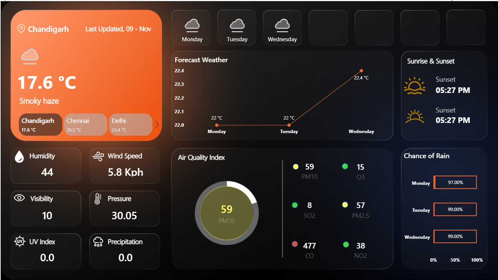

# 🌦️ Weather Analytics Dashboard — Power BI

## 📌 Project Overview

The **Weather Analytics Dashboard** is an interactive Power BI project designed to analyze and visualize weather conditions, short-term forecasts, and air-quality indicators for different locations.

As a Data Analyst, I developed this dashboard to transform raw weather data into a simple and interactive reporting solution. Instead of looking at raw weather information, users can quickly understand current conditions, temperature trends, rainfall probability, and air-quality levels through visual KPIs and charts.

The dashboard allows users to select a location and explore its weather and environmental conditions from a single view.

---

## 🎯 Business Objective

The main objective of this project is to answer practical questions such as:

- What are the current weather conditions in a selected location?
- What is the current humidity, wind speed, visibility, pressure, UV index, and precipitation?
- How is the temperature expected to change over the forecast period?
- What is the probability of rain on upcoming days?
- What are the current air-quality levels?
- Which pollutants are contributing to the overall air-quality condition?
- Can weather and environmental information be presented in a way that supports quick decision-making?

---

## 📊 Dashboard Features

### 1. Location Selection

The dashboard contains an interactive **Location Slicer** that allows users to select a location.

Changing the location dynamically updates the weather and air-quality information displayed on the dashboard.

### 2. Current Weather Analysis

The dashboard provides key current-weather indicators including:

- Weather Condition
- Humidity
- Wind Speed
- Visibility
- Atmospheric Pressure
- UV Index
- Precipitation

### 3. Temperature Forecast

A line chart is used to analyze the forecasted average temperature across upcoming days.

This makes it easy to identify:

- Temperature trends
- Warmer and cooler days
- Changes in expected weather conditions

### 4. Rain Probability Analysis

A visual comparison is provided for the expected **daily chance of rain**.

This helps users identify days where rainfall is more likely and understand upcoming weather conditions at a glance.

### 5. Air Quality Analysis

The dashboard includes important air-pollution indicators:

- **O₃** — Ozone
- **PM2.5** — Fine particulate matter
- **PM10** — Particulate matter
- **SO₂** — Sulfur dioxide
- **CO** — Carbon monoxide
- **NO₂** — Nitrogen dioxide

PM10 is also highlighted using a dedicated visual to make the pollutant level easier to interpret.

---

## 📈 Key KPIs

| Category | KPI |
|---|---|
| Weather | Current Weather Condition |
| Weather | Humidity |
| Weather | Wind Speed |
| Weather | Visibility |
| Weather | Atmospheric Pressure |
| Weather | UV Index |
| Weather | Precipitation |
| Forecast | Average Temperature |
| Forecast | Daily Chance of Rain |
| Air Quality | O₃ |
| Air Quality | PM2.5 |
| Air Quality | PM10 |
| Air Quality | SO₂ |
| Air Quality | CO |
| Air Quality | NO₂ |

---

## 🔍 Data Analysis Approach

As a Data Analyst, I followed this workflow:

```text
Raw Weather Data
       ↓
Data Preparation
       ↓
Data Transformation
       ↓
Data Modeling
       ↓
DAX Measures
       ↓
Interactive Visualizations
       ↓
Weather & Air Quality Insights
```

### Data Preparation

The weather data was organized into logical sections covering:

- Location information
- Current weather information
- Forecast information
- Air-quality information
- Analytical measures

### Data Transformation

Power Query was used to clean, transform, and prepare the data for analysis.

### Data Modeling

The data was structured to allow weather, forecast, location, and air-quality information to interact correctly with dashboard filters and visuals.

### DAX

DAX measures were used to support analytical calculations and dashboard indicators.

### Visualization

Power BI visuals were selected based on the analytical requirement:

- **KPI Cards** → Current weather and air-quality metrics
- **Line Chart** → Temperature forecast
- **100% Stacked Bar Chart** → Rain probability
- **Donut Chart** → PM10 indicator
- **Slicers** → Location and forecast filtering

---

## 💡 Analytical Insights

The dashboard helps users identify several useful patterns.

### Weather Conditions

Users can quickly evaluate humidity, wind speed, visibility, pressure, UV index, and precipitation for a selected location.

### Temperature Trend

The forecast line chart provides a clear view of how average temperature is expected to change over the forecast period.

### Rainfall Probability

The rain-probability visualization makes it easier to identify days with relatively higher or lower chances of rainfall.

### Air Quality

Multiple pollutants are monitored together, providing a broader view of environmental conditions rather than relying on a single air-quality metric.

---

## 🛠️ Tools & Technologies

- **Microsoft Power BI**
- **Power Query**
- **DAX**
- **Data Modeling**
- **Data Visualization**
- **Weather & Environmental Data**

---

# 🖼️ Dashboard Preview


---

```text
Weather-Analytics-Dashboard/
│
├── Weather Dashboard.pbix
├── README.md
│
└── Screenshots/
    └── weather-dashboard.png
```

Then display it in the README:

```markdown

```

The dashboard provides an interactive view of weather conditions, temperature forecasts, rain probability, and air-quality indicators.

---

# 🚀 How to Use

### 1. Clone the Repository

```bash
git clone https://github.com/your-username/weather-analytics-dashboard.git
```

### 2. Open the Project

Open the `.pbix` file using **Microsoft Power BI Desktop**.

### 3. Refresh the Data

If the project is connected to an external or live data source, configure the required data source connection and select:

**Home → Refresh**

### 4. Explore the Dashboard

Use the available filters and slicers to:

- Select a location
- Analyze current weather conditions
- View temperature forecasts
- Check rain probability
- Analyze air-quality indicators

### 5. Interact with the Visuals

Clicking on charts, KPIs, or other visual elements will dynamically filter related information throughout the dashboard.

---

## 🎓 What I Learned

Through this project, I strengthened my practical understanding of:

- Power BI dashboard development
- Data cleaning and transformation
- Power Query
- Data modeling
- DAX measures
- KPI design
- Interactive slicers
- Forecast analysis
- Air-quality analysis
- Data storytelling
- Dashboard design
- Business-focused reporting

This project helped me understand how a Data Analyst can transform raw data into an interactive dashboard that communicates information clearly and supports decision-making.

---

## 🚀 Future Improvements

Possible improvements include:

- Historical weather analysis
- Weather comparison between multiple cities
- Monthly and yearly temperature trends
- Historical air-quality trends
- AQI classification
- Weather alerts
- Rainfall trend analysis
- Correlation between weather and air quality
- Interactive maps
- Automated data refresh
- Mobile-optimized Power BI layout

---

## 📌 Project Highlights

**Project Type:** Data Analytics / Business Intelligence

**Domain:** Weather & Environmental Analytics

**Primary Tool:** Microsoft Power BI

**Techniques:** Data Cleaning, Data Transformation, Data Modeling, DAX, KPI Analysis, Data Visualization

**Key Analysis Areas:** Current Weather, Forecast, Rain Probability, Air Quality

---

# 👨‍💻 Author

**Sourabh Mondal**

Data Analysis | Power BI | SQL | Excel

- GitHub: [github.com/sourabhmondal9](https://github.com/sourabhmondal9?tab=repositories)
- LinkedIn: [linkedin.com/in/sourabhmondal14081999](https://www.linkedin.com/in/sourabhmondal14081999)

---

# ⚠️ Disclaimer

This project is created for **educational and portfolio purposes**.

If the dataset is obtained from a public source, the original source and attribution should be added to this repository.

Do not publish confidential, private, or personally identifiable information.

---

## ⭐ Project Focus

**Data → Analysis → Visualization → Business Insights**

---

## ⭐ Support

If you find this project useful, consider giving the repository a **star ⭐**.

Feedback and suggestions are welcome.
